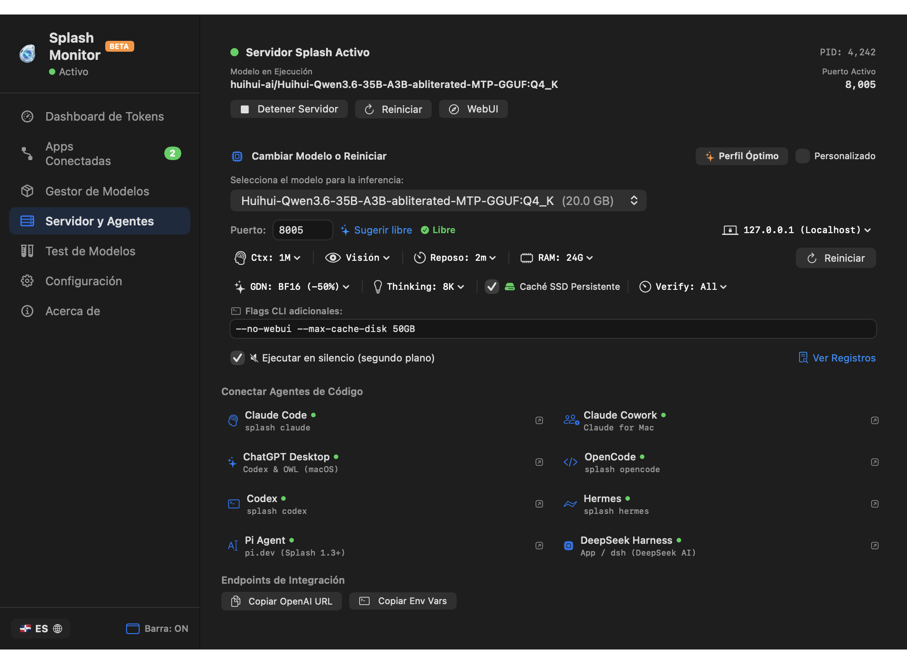
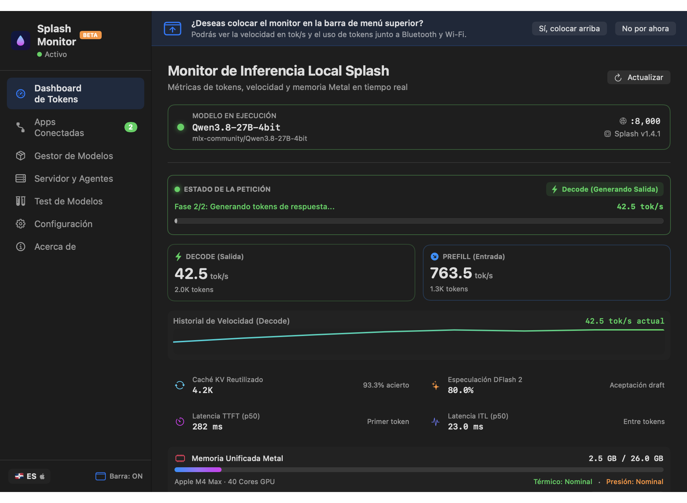
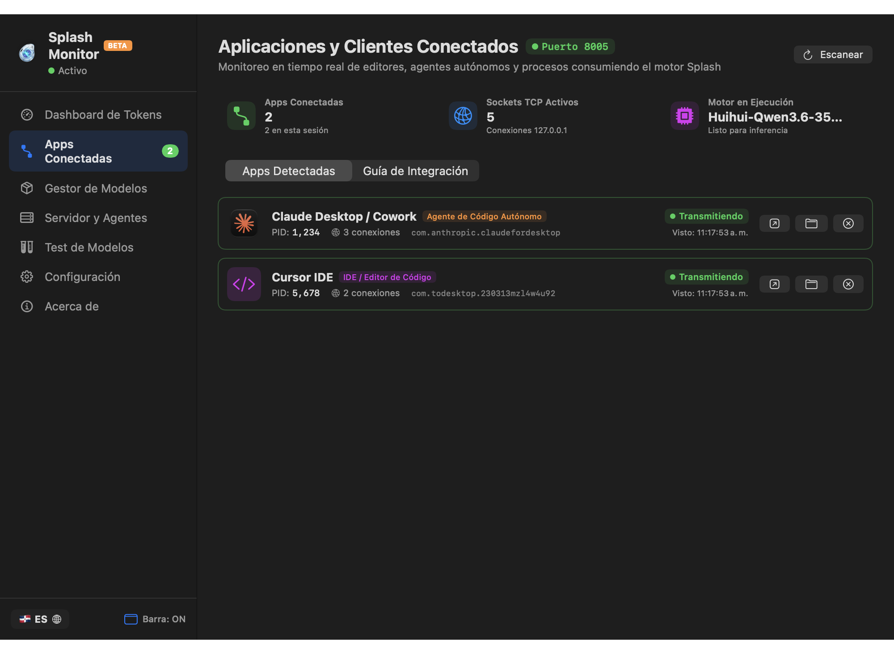
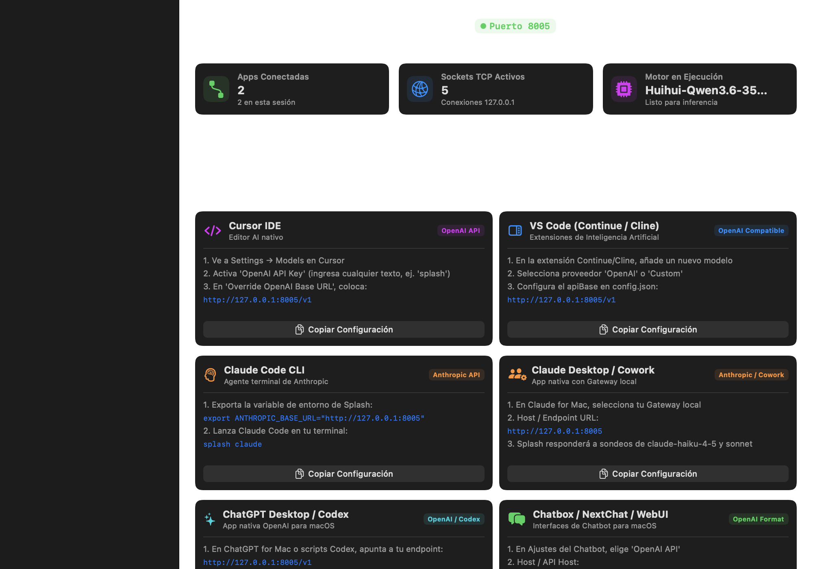
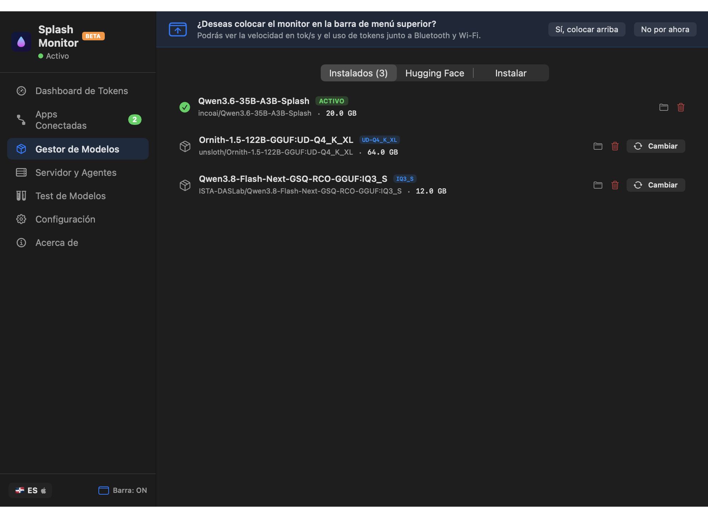
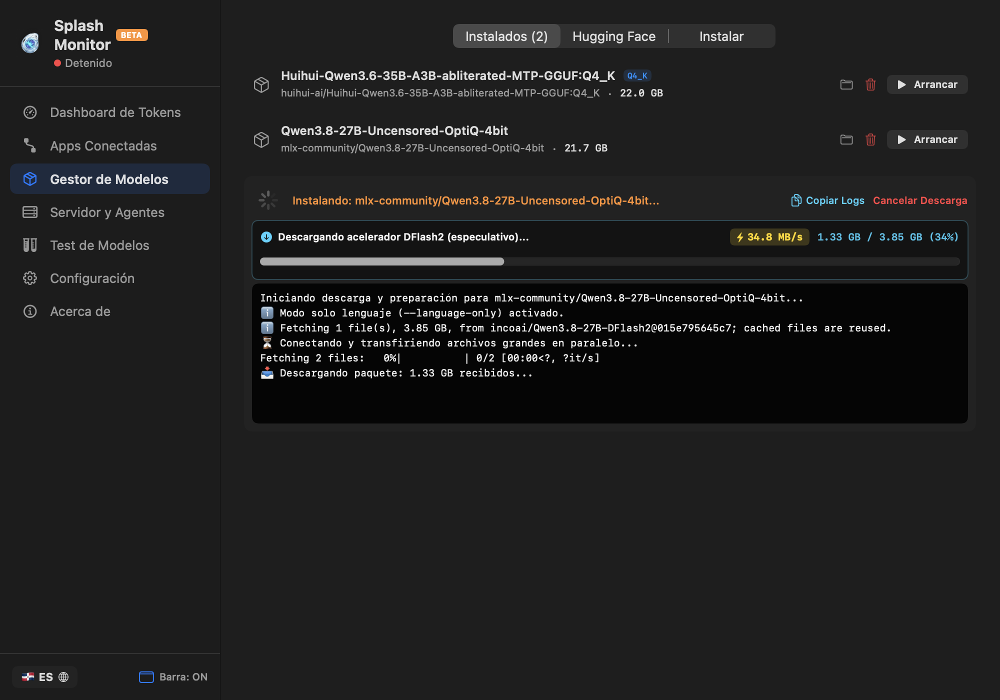
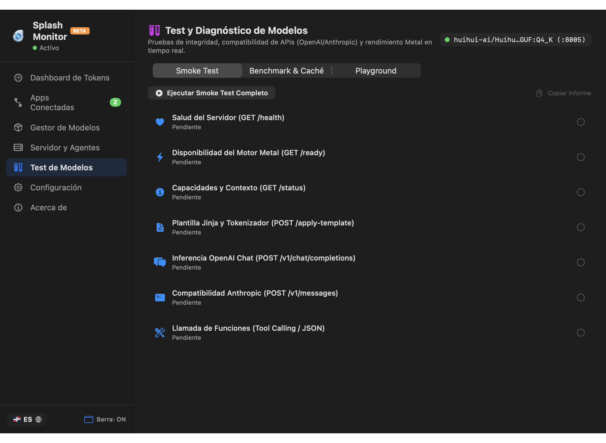
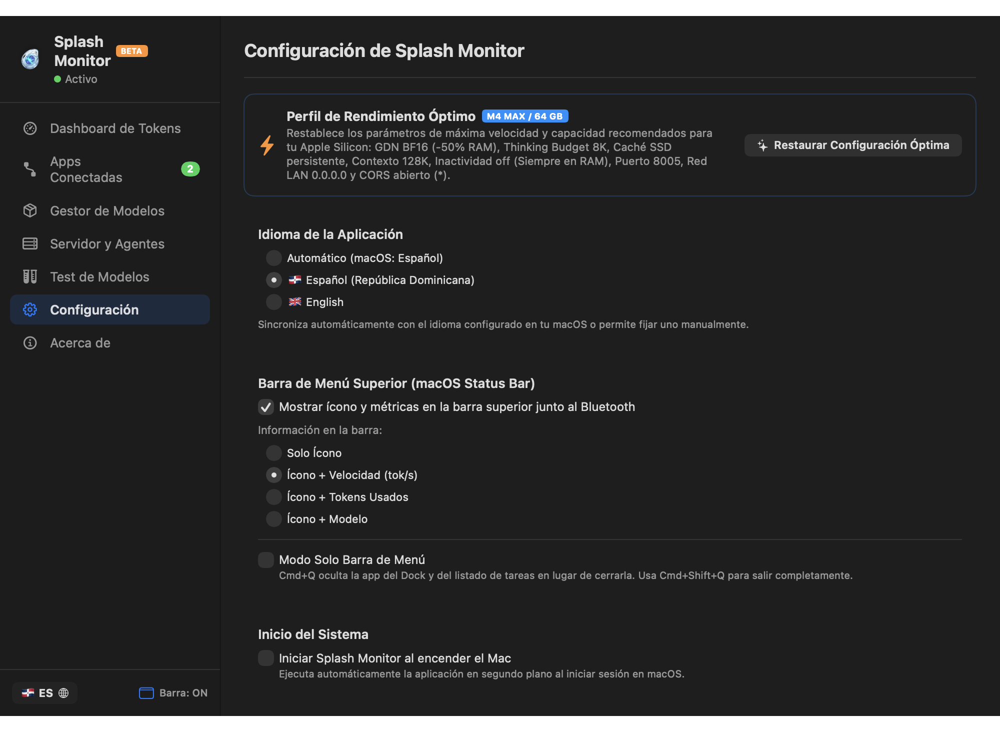
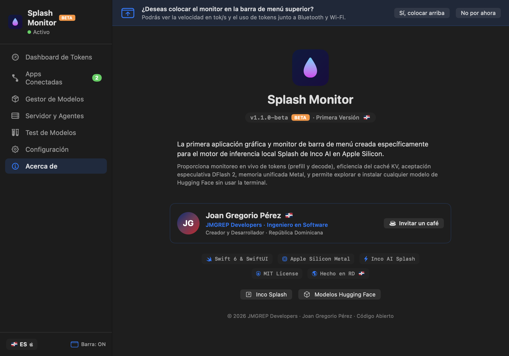

<div align="center">

<!-- Splash Monitor — Professional README -->

<a href="https://inco.ai/blog/splash/">
  
</a>

# 🌊 Splash Monitor

### The first native macOS desktop app for [Inco AI's Splash](https://inco.ai/blog/splash/) local inference engine

*El primer app de escritorio nativo de macOS para el motor de inferencia local [Splash de Inco AI](https://inco.ai/blog/splash/)*

<br/>

[](https://developer.apple.com/macos/)
[](https://www.swift.org/)
[](https://www.apple.com/silicon/)
[](https://github.com/hometrix/SplashMonitor/releases/tag/v1.1.0-beta)
[](https://github.com/hometrix/SplashMonitor/releases/download/v1.1.0-beta/SplashMonitor-1.1.0-beta.dmg)
[](LICENSE)
[](#-autor--author)
[](https://buymeacoffee.com/hometrix9)

<br/>

<div align="center">
  
  <p><b>🕹️ Servidor de Inferencia Local y Lanzadores de Agentes (Claude Cowork, Claude Code, OpenCode, Codex, Hermes, Pi, DeepSeek Harness)</b></p>
</div>

<br/>

**[🇪🇸 Español](#-español)** &nbsp;·&nbsp; **[🇬🇧 English](#-english)**

</div>

---

<div id="-español"></div>

## 🇩🇴 Español

### ¿Por qué Splash Monitor?

Hasta ahora, [Splash](https://inco.ai/blog/splash/) solo podía operarse desde la línea de comandos. **Splash Monitor** transforma esa experiencia en una suite visual completa para macOS: monitoreo de métricas en tiempo real, gestión de modelos de Hugging Face con un solo clic, y lanzadores de agentes de código — todo desde un ícono en la barra de menú o una ventana de escritorio nativa.

---

### 🚀 Novedades de la Versión 1.1.0-beta

- 🌐 **100% Internacionalización Bilingüe (Español / Inglés — Resuelve #5)**: Cobertura total y natural en ambas lenguas para toda la app: controles del servidor, validadores de identificadores de modelos (`ModelIDValidator`), alertas de rechazo accionables, modales de confirmación y notificaciones.
- ⚡ **Monitor en Vivo del Ciclo de Vida de Inferencia (Resuelve #6)**: Visualización en tiempo real en el Dashboard de las fases del motor: **`PREFILL`** (evaluando KV Cache y prompt en azul) ➔ **`DECODE`** (generación de tokens en verde con medidor tok/s y contador en vivo) ➔ **`IDLE / QUEUED`**.
- 👁️ **Modalidad Multimodal por Defecto (Visión + Texto)**: Splash arranca por defecto con visión activada sin configuraciones manuales, con auto-fallback inteligente a `--language-only` si un modelo puramente de código carece de proyector visual (`mmproj`).
- 🔔 **Notificaciones Nativas y Auto-Arranque con macOS**: Alertas del sistema vía `UNUserNotificationCenter` al iniciar el servidor o completar descargas, e integración moderna de inicio de sesión con `SMAppService`.
- 📌 **Modo Solo Barra de Menú (Resuelve #4)**: Opción para ocultar el ícono del Dock al cerrar la ventana (`Cmd+Q`) manteniendo el monitor en segundo plano.
- 🤖 **Compatibilidad con Splash 1.4.1**: Soporte oficial para `Ornith-1.5-122B` y `Flint 40B-A2.5B MoE` (~190 tok/s en Apple Silicon).
- 🛡️ **120 Pruebas Unitarias al 100% Passing**: Protección estricta contra inyección en shell, centinela de memoria Metal (`SystemMemoryPressureSentinel`) y concurrencia segura `@MainActor`.

---

### ✨ Características Principales

<table>
<tr>
<td width="50%" valign="top">

#### 📊 Dashboard de Métricas en Tiempo Real
- Velocidades de **prefill** y **decode** en `tok/s` con gráficas sparkline
- Monitoreo de la tasa de acierto del **KV Cache** y ahorro de tokens
- Tasa de aceptación especulativa de **DFlash 2**
- Métricas de latencia **TTFT** e **ITL** (percentil p50)
- Estado térmico y aceleración por **Apple Neural Engine (ANE)**

</td>
<td width="50%" valign="top">

#### 💾 Monitor de Memoria Unified Metal
- Barra de uso de memoria en tiempo real (ej. `23.7 GB / 55.6 GB`)
- Detección automática del procesador Apple Silicon y cores GPU
- **Centinela de Presión de Memoria del Sistema** (`dispatch_source_t`) con alertas (`Normal`, `Warning`, `Critical`) y purga bajo demanda (`POST /v1/memory/release`)
- Indicador de estado de pesos en reposo (`weights.released`) y ahorro de RAM

</td>
</tr>
<tr>
<td width="50%" valign="top">

#### 📦 Gestor de Modelos
- Catálogo de modelos locales instalados con cálculo de espacio en disco
- Explorador del catálogo en vivo de [Hugging Face](https://huggingface.co/incoai), `mlx-community` y modelos oficiales **NVIDIA (NVFP4 / FP8)**
- Telemetría en vivo de velocidad de descarga (`MB/s`), fases y barra de progreso continua
- Detección y asistencia explicativa para repositorios protegidos (*403 Gated Models*)
- Soporte para variantes GGUF y modo `--language-only`

</td>
<td width="50%" valign="top">

#### 🕹️ Control del Servidor
- Selector de modelo interactivo con cambio en caliente
- Iniciar / detener el servidor en un clic
- Lanzadores de agentes: **Claude Code**, **Claude Cowork**, **OpenCode**, **Codex**, **Hermes**, **Pi Agent** (`pi.dev`) y **DeepSeek Harness** (`dsh`)
- Opciones avanzadas Splash 1.3.2: formato de estado GDN (`--state-format bf16`), presupuesto de razonamiento (`--thinking-token-budget`), caché SSD persistente (`--persistent-cache`)
- Selección de puerto, enlace de red LAN (0.0.0.0 / 127.0.0.1), dominios o hosts permitidos (`--allowed-host`), límite de contexto (`--max-context`) y banderas CLI personalizadas
- Copia de endpoint compatible con OpenAI

</td>
</tr>
<tr>
<td width="50%" valign="top">

#### 🌐 Detección Automática de Idioma
- Sincronización dinámica con el idioma de macOS
- Cambio en tiempo real sin reiniciar la app
- Control manual: Español 🇩🇴 / English 🇬🇧

</td>
<td width="50%" valign="top">

#### 🍎 Experiencia Nativa de macOS
- **Menu bar extra** con 4 modos de visualización y purga de memoria en 1 clic
- Icono 3D gota líquida con transparencia alpha completa
- `NavigationSplitView` con **8 secciones** en la barra lateral
- Compatibilidad con macOS 13.0+ en Apple Silicon

</td>
</tr>
</table>

---

### 📸 Galería Visual de Todos los Módulos

Cada módulo de **Splash Monitor** está optimizado para la experiencia nativa de macOS en Apple Silicon:

<div align="center">

#### 1. 🕹️ Servidor y Lanzadores de Agentes (con Claude Cowork y DeepSeek Harness)

<p><b>Módulo de Control del Servidor:</b> Inicia y detiene el servidor Splash en un solo clic, cambia el modelo en caliente, configura el puerto, estado recurrente GDN en BF16 (-50% RAM), presupuesto de tokens de razonamiento, caché SSD persistente y lanza agentes autónomos: <b>Claude Cowork</b> (activación de app nativa con aliases para evitar errores 404), <b>Claude Code CLI</b>, <b>OpenCode</b>, <b>Codex</b>, <b>Hermes</b>, <b>Pi Agent</b> y <b>DeepSeek Harness (`dsh`)</b>.</p>

<br/>

#### 2. 📊 Dashboard de Tokens y Rendimiento Metal

<p><b>Módulo de Rendimiento en Tiempo Real:</b> Monitorea velocidades de generación de tokens (DECODE y PREFILL en tok/s), ratio de acierto y reutilización de KV Cache, deduplicación de tokens, aceptación especulativa DFlash 2, latencias TTFT/ITL y uso de memoria unificada Metal (M3/M4/M5).</p>

<br/>

#### 3. 🔌 Aplicaciones y Clientes Conectados

<p><b>Módulo de Clientes Conectados:</b> Inspección automática de conexiones TCP activas contra el puerto de inferencia, reconociendo clientes como <b>Claude Desktop / Cowork</b>, <b>DeepSeek Harness</b>, Cursor IDE, VS Code y Chatbots con sus íconos nativos y estado de transmisión.</p>

<br/>

#### 4. 📖 Guía Rápida de Conexión y Gateway

<p><b>Módulo de Guía de Conexión:</b> Pasos y comandos de un clic para configurar el Gateway local en Claude Desktop, Cursor IDE, VS Code (Cline/Continue), Chatbox y scripts Python (OpenAI SDK / LangChain).</p>

<br/>

#### 5. 📦 Gestor de Modelos y Telemetría de Descargas

<p><b>Módulo de Modelos:</b> Control de modelos locales en disco con espacio utilizado, cambio en caliente y exploración del catálogo de Hugging Face con soporte para cuantizaciones oficiales NVIDIA (NVFP4 / FP8), variantes GGUF, guía asistida para repositorios protegidos (403 Gated) y modo <code>--language-only</code> para modelos de código y texto.</p>


<p><b>Telemetría de Descarga en Tiempo Real:</b> Medición en vivo de la tasa de transferencia en MB/s (<code>⚡️ 34.8 MB/s</code>), barra de progreso continuo, contador exacto de GB descargados frente al total esperado y detección de fases (acelerador especulativo DFlash2, pesos del modelo y ensamblado Splash).</p>

<br/>

#### 6. 🧪 Test y Diagnóstico de Modelos (Model Lab)

<p><b>Módulo de Test y Diagnóstico:</b> Suite completa de verificación en un clic con Smoke Test (salud del servidor, disponibilidad Metal, plantilla Jinja, OpenAI Chat, Anthropic Messages y llamadas a herramientas/JSON), Benchmarking de velocidad con cálculo del factor de aceleración del KV Cache y Playground interactivo de inferencia local.</p>

<br/>

#### 7. ⚙️ Configuración del Sistema

<p><b>Módulo de Ajustes:</b> Selector de idioma (Español Dominicano 🇩🇴 / English 🇬🇧 / macOS automático), configuración del ícono en la barra de menú superior de macOS y frecuencia de refresco.</p>

<br/>

#### 8. ℹ️ Acerca de Splash Monitor

<p><b>Módulo Informativo:</b> Información de versión (v1.1.0-beta), arquitectura nativa en Swift 6 y Metal, licencia abierta MIT y créditos de autoría de Joan Gregorio Pérez (JMGREP Developers).</p>
</div>

---

### 📥 Instalación

#### Requisitos Previos — Motor Splash de Inco AI

Splash Monitor es un monitor gráfico para el motor de inferencia local **[Splash](https://github.com/incoai/splash)** de Inco AI. Antes de instalar Splash Monitor, necesitas tener Splash funcionando en tu Mac.

**Instala Splash desde el repositorio oficial de Inco AI:**

```bash
# Agregar el tap oficial de Inco AI e instalar Splash
brew install incoai/tap/splash
```

> 📋 **Requisitos del motor Splash** (según [incoai/splash](https://github.com/incoai/splash)):
> - Mac con Apple Silicon **M3 o posterior**
> - **macOS 26.4** (Tahoe) o posterior
> - **36 GB** de memoria unificada (48 GB o más recomendado)
>
> Los modelos se descargan automáticamente en el primer uso. Consulta los modelos disponibles en [huggingface.co/incoai](https://huggingface.co/incoai).

Una vez que Splash esté instalado y funcionando, instala Splash Monitor:

#### Opción A — Homebrew Cask (Recomendada Oficial · Sin Alertas de Gatekeeper)

La forma nativa y recomendada en macOS. Al instalar mediante Homebrew, macOS no aplica cuarentena de navegador y la app abre de inmediato:

```bash
brew install --cask hometrix/tap/splash-monitor
```

> ⚠️ **Comprueba la versión que instala el cask.** El cask del tap es un fichero aparte
> (`hometrix/homebrew-tap`) y puede quedarse atrás respecto a las publicaciones de este
> repositorio: en la auditoría de la v1.0.2-beta el cask seguía sirviendo la 1.0.0-beta.
> Verifica con `brew info --cask splash-monitor` o `Splash Monitor.app/Contents/Info.plist`.
> Si el cask está atrasado, usa la Opción B o C, que siempre apuntan a la última publicación.

---

#### Opción B — Instalación en 1 Línea (Terminal / Script)

La forma más rápida si no deseas usar Homebrew tap:

```bash
curl -fsSL https://raw.githubusercontent.com/hometrix/SplashMonitor/main/scripts/install.sh | bash
```

> ⚡️ Este comando consulta la última publicación en GitHub, descarga el DMG oficial,
> **verifica su suma SHA-256** contra el fichero `SHA256SUMS` publicado y aborta si no
> coincide, lo monta, copia la app a `/Applications` y la abre automáticamente.
> Fija una versión concreta con `SPLASH_MONITOR_TAG=v1.1.0-beta`.

---

#### Opción C — Descarga Manual del DMG

1. **Descarga** el instalador oficial:
   👉 [**SplashMonitor-1.1.0-beta.dmg**](https://github.com/hometrix/SplashMonitor/releases/download/v1.1.0-beta/SplashMonitor-1.1.0-beta.dmg)

   Y su suma de verificación: [**SHA256SUMS**](https://github.com/hometrix/SplashMonitor/releases/download/v1.1.0-beta/SHA256SUMS)

   ```bash
   shasum -a 256 -c SHA256SUMS   # debe imprimir "OK"
   ```

2. Haz doble clic en el `.dmg` descargado y arrastra **Splash Monitor** a **Aplicaciones**.

> 🛡️ **Si macOS muestra: "Apple no ha podido verificar que no contenga software malicioso..."**:
> Este aviso lo impone macOS a todas las apps de código abierto sin licencia de pago de Apple. Para abrirla:
> 1. Ve a **Ajustes del Sistema** en tu Mac.
> 2. Haz clic en **Privacidad y seguridad** (en la barra lateral) y baja hasta **Seguridad**.
> 3. Pulsa el botón **"Abrir de todas formas"** (*Open Anyway*).
> 
> *O por Terminal (1 segundo):*
> ```bash
> xattr -d com.apple.quarantine ~/Downloads/SplashMonitor*.dmg
> ```

---

#### Opción B — Compilar desde Código Fuente (Desarrolladores)

**Requisitos:**

| Requisito | Versión Mínima |
|-----------|---------------|
| Mac | Apple Silicon (M3, M4, M5) |
| macOS | 13.0 o superior |
| Xcode | 15+ o Swift 6.0 Toolchain |
| Splash Engine | [incoai/tap/splash](https://github.com/incoai/splash) |

```bash
# 1. Clonar el repositorio
gh repo clone hometrix/SplashMonitor
cd SplashMonitor

# 2. Ejecutar la batería de pruebas (64 pruebas, sin red ni motor real)
swift test

# 3. Compilar la app y generar el bundle .app
./scripts/build_app.sh

# 4. (Opcional) Generar el instalador DMG comprimido + SHA256SUMS
./scripts/create_dmg.sh

# 5. Iniciar la aplicación
open "Splash Monitor.app"
```

> 🔢 **Versión única.** `Sources/SplashMonitor/Services/Version.swift` es la única fuente
> de la versión, el identificador de paquete y el número de compilación. Los tres scripts
> los extraen de ahí con `sed`: no hay que editar la versión en varios sitios (antes se
> declaraba en cinco lugares y ya habían divergido entre sí).

#### 🧪 Pruebas

```bash
swift test                                   # 113 pruebas (100% de éxito)
swift test --filter PollingTests             # solo una suite
swift test --filter ServerOptionsTests       # opciones CLI y Splash 1.3.2
swift test --filter SystemMemoryPressureTests # centinela de memoria macOS
```

Las pruebas son herméticas por diseño: usan un transporte de estado simulado, un
terminador de procesos simulado, un directorio temporal propio y `bootstrapNetwork: false`
(sin tráfico a Hugging Face ni a GitHub). **Ninguna prueba envía señales a procesos reales
ni escribe en tu `~/.zshrc`.** Cubren, entre otras cosas:

| Suite | Qué protege |
|-------|-------------|
| `VersionTests` | Orden semántico de versiones y unicidad de la versión del producto |
| `ModelIDValidatorTests` | Rechazo de identificadores de modelo con inyección de shell y rutas `..` |
| `ProcessIntrospectionTests` | Que nunca se señalice a un cliente conectado, solo a escuchas del motor |
| `ServeLockTests` | Lectura de `serve-<puerto>.lock`, bloqueos vacíos, corruptos y huérfanos |
| `ShellEnvironmentTests` | Contenido del entorno, reversión exacta del `~/.zshrc` y consentimiento |
| `ModelSizeCacheTests` | Que el sondeo no vuelva a recorrer el árbol de modelos en cada ciclo |
| `PollingTests` | Que el panel siga detectando el motor tras detenerlo o arrancarlo tarde |
| `ClientTerminationPolicyTests` | Que no se termine un PID reciclado ni la propia app |
| `StatusModelTests` | Contrato real de `/status` del motor y tolerancia a claves nuevas |
| `ServerCLIValidatorTests` | Validación y sanitización estricta de banderas CLI, estados GDN y presupuestos |
| `ServerOptionsTests` | Generación de comandos con host LAN, variantes, estado GDN BF16 y flags 1.3.2 |
| `AgentLaunchTests` | Detección e integración de lanzadores para Claude Cowork, Pi, Hermes y DeepSeek Harness |
| `SystemMemoryPressureTests` | Notificaciones del centinela de memoria del kernel macOS y purga bajo demanda |
| `ModelDiagnosticTests` | Batería de validación de endpoints y benchmarking de inferencia Metal |

---

### 🏗️ Arquitectura del Proyecto

```
SplashMonitor/
├── Package.swift                    # Manifiesto Swift Package Manager
├── LICENSE                          # Licencia MIT
├── CONTRIBUTING.md                  # Guías de contribución (bilingüe)
├── SECURITY.md                      # Política de divulgación responsable
├── CODE_OF_CONDUCT.md               # Código de Conducta Contributor Covenant v2.1
├── README.md                        # Documentación técnica bilingüe
├── Resources/
│   ├── AppIcon.icns                 # Bundle de icono multi-resolución
│   └── AppIcon.iconset/             # Assets de icono estándar y Retina
├── scripts/
│   ├── build_app.sh                 # Build Release + empaquetado .app
│   ├── create_dmg.sh                # Empaquetado DMG vía hdiutil + SHA256SUMS
│   └── install.sh                   # Instalador en 1 línea con verificación SHA-256
└── Sources/
    └── SplashMonitor/
        ├── SplashMonitorApp.swift   # Entry point (WindowGroup + MenuBarExtra)
        ├── Models/
        │   └── SplashStatus.swift   # Structs Codable para /status y HF API
        ├── Services/
        │   ├── SplashService.swift  # Singleton (polling, procesos, servidor)
        │   ├── LocalizationService.swift # Detección dinámica del idioma
        │   ├── SystemMemoryPressureSentinel.swift # Centinela de presión de RAM macOS
        │   ├── ServerCLIValidator.swift  # Sanitización y validación de flags CLI
        │   ├── ModelIDValidator.swift    # Validación estricta de IDs de modelos
        │   ├── ModelBenchmarkRunner.swift # Benchmark de tokens y aceleración KV
        │   └── Version.swift        # Fuente única de versión semántica (P-15)
        └── Views/
            ├── MainWindowView.swift # NavigationSplitView de escritorio (8 módulos)
            ├── MenuBarView.swift    # Popover interactivo del menú superior
            ├── TokenMetricsView.swift # Sparkline, tarjetas de velocidad, gauge
            ├── ModelManagerView.swift # Modelos locales + catálogo HF + telemetría
            ├── ServerControlView.swift # Selector, controles, lanzadores, flags 1.3.2
            ├── ConnectedAppsView.swift # Apps conectadas + DeepSeek Harness
            ├── ConnectedAppsGuideView.swift # Guía de integración de clientes
            ├── ModelTestingView.swift  # Smoke testing + benchmarking + playground
            ├── SettingsView.swift   # Ajustes de idioma, menú y sondeo
            ├── AboutView.swift      # Créditos e info de versión
            ├── AppIconView.swift    # Renderizado del icono de la app
            └── DominicanEmblem.swift # Emblema patrio dominicano
```

---

### 🛠️ Stack Tecnológico

| Componente | Tecnología |
|:-----------|:-----------|
| **Lenguaje** | Swift 6 |
| **UI Framework** | SwiftUI |
| **Package Manager** | Swift Package Manager |
| **Plataforma** | macOS 13.0+ (Apple Silicon) |
| **Motor de Inferencia** | [Inco AI Splash](https://inco.ai/blog/splash/) |
| **Catálogo de Modelos** | [Hugging Face API](https://huggingface.co/incoai) |
| **Icono** | Custom 3D liquid droplet (SF Symbols + Canvas) |
| **Empaquetado** | `hdiutil` (DMG nativo de macOS) |

---

### 🤝 Contribuir

¡Las contribuciones son bienvenidas! Consulta nuestras guías antes de participar:

| Documento | Descripción |
|:----------|:------------|
| 📋 [Guía de Contribución](CONTRIBUTING.md) | Flujo de trabajo, convenciones de código y estructura del proyecto |
| 🔒 [Política de Seguridad](SECURITY.md) | Divulgación responsable de vulnerabilidades |
| 📜 [Código de Conducta](CODE_OF_CONDUCT.md) | Contributor Covenant v2.1 |

---

### 👤 Autor y Créditos

<table>
<tr>
<td align="center" width="80">
  
</td>
<td>
  <b>Joan Gregorio Pérez</b><br/>
  <i>Software Engineer · JMGREP Developers</i><br/>
  🇩🇴 República Dominicana<br/>
  <a href="https://github.com/hometrix">GitHub</a>
</td>
</tr>
</table>

**Agradecimientos especiales:**
- [Inco AI](https://inco.ai/blog/splash/) — Motor de inferencia Splash
- [Hugging Face](https://huggingface.co/incoai) — Catálogo de modelos

---

### 💖 Apoyar el Proyecto

Si **Splash Monitor** te resulta útil para tus flujos de trabajo de IA local y desarrollo con agentes, ¡considera apoyar su desarrollo continuo invitándome a un café! Cada aporte ayuda a mantener el proyecto actualizado, probado y optimizado para Apple Silicon.

<p align="left">
  <a href="https://buymeacoffee.com/hometrix9" target="_blank">
    
  </a>
</p>

---

### 📄 Licencia

Este proyecto está licenciado bajo la **Licencia MIT**. Consulta el archivo [LICENSE](LICENSE) para los términos completos.

```
MIT License — Copyright (c) 2026 JMGREP Developers / Joan Gregorio Pérez
```

#### Atribuciones y Licencias de Componentes

Splash Monitor es una aplicación independiente de código abierto que interactúa con el motor Splash, modelos de inteligencia artificial y agentes de código autónomos. A continuación se detallan las licencias y atribuciones de cada componente:

##### 1. Motor de Inferencia y Monitor
| Componente | Licencia | Autor / Organización | Repositorio |
|:-----------|:---------|:---------------------|:------------|
| **Splash Monitor** | MIT | JMGREP Developers (Joan Gregorio Pérez) | [hometrix/SplashMonitor](https://github.com/hometrix/SplashMonitor) |
| **Splash Engine** | Apache-2.0 | Inco AI | [incoai/splash](https://github.com/incoai/splash) |

##### 2. Modelos Cuantizados y Aceleradores Especulativos (Splash 1.3.1 / 1.3.2)
| Modelo / Checkpoint | Licencia | Distribuidor / Creador | Repositorio |
|:--------------------|:---------|:-----------------------|:------------|
| **Qwen3.8-27B-NVFP4** | Apache-2.0 | NVIDIA Model Optimizer | [nvidia/Qwen3.8-27B-NVFP4](https://huggingface.co/nvidia/Qwen3.8-27B-NVFP4) |
| **Qwen3.6-35B-A3B-nvfp4** | Apache-2.0 | MLX Community | [mlx-community/Qwen3.6-35B-A3B-nvfp4](https://huggingface.co/mlx-community/Qwen3.6-35B-A3B-nvfp4) |
| **Qwen3.8-27B-4bit** | Apache-2.0 | MLX Community | [mlx-community/Qwen3.8-27B-4bit](https://huggingface.co/mlx-community/Qwen3.8-27B-4bit) |
| **Qwen3.6-35B-A3B-4bit** | Apache-2.0 | MLX Community | [mlx-community/Qwen3.6-35B-A3B-4bit](https://huggingface.co/mlx-community/Qwen3.6-35B-A3B-4bit) |
| **DFlash 2 Speculative Decoders** | Apache-2.0 | Inco AI | [incoai/Qwen3.8-27B-DFlash2](https://huggingface.co/incoai/Qwen3.8-27B-DFlash2) |
| **Qwen Base Models (27B & 35B)** | Apache-2.0 | Alibaba Cloud / Qwen Team | [Qwen/Qwen](https://github.com/QwenLM/Qwen) |
| **Variantes Cuantizadas GGUF** | Apache-2.0 / MIT | llama.cpp / Creadores Comunitarios | [Hugging Face Hub](https://huggingface.co) |

##### 3. Clientes y Agentes de Código Autónomos Conectados
| Agente / Cliente | Licencia / Términos | Desarrollador | Enlace Oficial |
|:-----------------|:--------------------|:--------------|:---------------|
| **DeepSeek Harness (`dsh`)** | MIT | DeepSeek Community | [GitHub](https://github.com/deepseek-ai) |
| **Pi Agent (`pi`)** | MIT | Mario Zechner / Pi.dev | [pi.dev](https://pi.dev) |
| **Hermes Agent** | MIT | Nous Research | [NousResearch](https://github.com/NousResearch) |
| **OpenCode** | MIT | SST | [opencode.ai](https://opencode.ai) |
| **Codex CLI** | Apache-2.0 / MIT | OpenAI Community | [OpenAI Developers](https://platform.openai.com) |
| **Claude Code & Cowork** | Términos de Servicio | Anthropic, PBC | [anthropic.com](https://www.anthropic.com) |

> ⚠️ **Aviso de Pesos de Modelos**: Los pesos, puntos de control (*checkpoints*) y cuantizaciones de modelos mantienen sus propios términos de licencia y acuerdos de uso de cada autor en Hugging Face Hub.

> ℹ️ **Descargo de Responsabilidad (*Disclaimer*)**: Splash Monitor es un proyecto independiente desarrollado por JMGREP Developers y **no está afiliado, patrocinado ni respaldado por Inco AI, Anthropic, OpenAI, NVIDIA o Alibaba Cloud**. "Splash" es una marca comercial de Inco AI. Este software interactúa con la API pública local del motor Splash bajo los términos de su licencia Apache-2.0.

---

<div id="-english"></div>

## 🇬🇧 English

### Why Splash Monitor?

Until now, [Splash](https://inco.ai/blog/splash/) could only be operated from the command line. **Splash Monitor** transforms that experience into a complete visual suite for macOS: real-time metrics monitoring, one-click Hugging Face model management, and code agent launchers — all from a menu bar icon or a native desktop window.

---

### 🚀 What's New in Version 1.1.0-beta

- 🌐 **100% Bilingual Localization (English / Spanish — Closes #5)**: Complete and natural English phrasing across all views, controls, model validators (`ModelIDValidator`), actionable rejection reasons, confirmation dialogs, and notifications.
- ⚡ **Live Inference Request Lifecycle Tracker (Closes #6)**: Interactive real-time pipeline in the Dashboard tracking engine stages: **`PREFILL`** (prompt ingestion & KV hit rate in blue) ➔ **`DECODE`** (streaming response generation with live tok/s meter and token count in green) ➔ **`IDLE / QUEUED`**.
- 👁️ **Multimodal by Default (Vision + Text)**: Splash now starts with Vision + Text enabled out of the box, with smart auto-fallback to `--language-only` for code-only models lacking vision projectors (`mmproj`).
- 🔔 **Native macOS Notifications & Login Auto-Launch**: Direct `UNUserNotificationCenter` system alerts when the server starts or downloads complete, plus modern login item management via Apple's `SMAppService`.
- 📌 **Menu Bar Only Mode (Closes #4)**: Option in Settings to hide the Dock icon upon closing the window (`Cmd+Q`), keeping the monitor running lightweight in the macOS menu bar.
- 🤖 **Splash 1.4.1 Compatibility**: Official support for `Ornith-1.5-122B` and `Flint 40B-A2.5B MoE` (~190 tok/s on Apple Silicon).
- 🛡️ **120 Automated Unit Tests (100% passing)**: Zero regressions, robust shell injection protection, Metal memory pressure sentinel (`SystemMemoryPressureSentinel`), and actor-isolated `@MainActor` concurrency.

---

### ✨ Key Features

<table>
<tr>
<td width="50%" valign="top">

#### 📊 Real-Time Token Dashboard
- **Prefill** and **decode** speeds in `tok/s` with sparkline charts
- **KV Cache** hit rate monitoring and token savings tracking
- **DFlash 2** speculative acceptance rate
- **TTFT** and **ITL** latency metrics (p50 percentile)
- Thermal monitoring and **Apple Neural Engine (ANE)** acceleration ratio

</td>
<td width="50%" valign="top">

#### 💾 Metal Unified Memory Gauge
- Real-time memory usage bar (e.g. `23.7 GB / 55.6 GB`)
- Automatic Apple Silicon chip and GPU core detection
- **macOS Kernel Memory Pressure Sentinel** (`dispatch_source_t`) with preemptive alerts (`Normal`, `Warning`, `Critical`) and on-demand flush (`POST /v1/memory/release`)
- Idle weights status indicator (`weights.released`) and RAM savings

</td>
</tr>
<tr>
<td width="50%" valign="top">

#### 📦 Model Manager
- Local installed models catalog with disk footprint calculation
- Live [Hugging Face](https://huggingface.co/incoai), `mlx-community`, and official **NVIDIA (NVFP4 / FP8)** catalog explorer
- Real-time download transfer speed telemetry (`MB/s`), phases, and continuous progress bar
- Explanatory guidance for protected repositories (*403 Gated Models*)
- Support for quantized GGUF variants and `--language-only` mode

</td>
<td width="50%" valign="top">

#### 🕹️ Server Controls
- Interactive model selector with hot-swapping
- Start / stop the server with one click
- Code agent launchers: **Claude Code**, **Claude Cowork**, **OpenCode**, **Codex**, **Hermes**, **Pi Agent** (`pi.dev`), and **DeepSeek Harness** (`dsh`)
- Advanced Splash 1.3.2 options: GDN state format (`--state-format bf16`), reasoning token budget (`--thinking-token-budget`), persistent SSD prefix cache (`--persistent-cache`)
- Port selection, LAN network bind (0.0.0.0 / 127.0.0.1), allowed domains or hosts (`--allowed-host`), context limit (`--max-context`), and custom CLI flags
- One-click OpenAI-compatible API endpoint copying

</td>
</tr>
<tr>
<td width="50%" valign="top">

#### 🌐 Auto Language Detection
- Dynamic sync with macOS system language
- Real-time switching without restart
- Manual toggle: Español 🇩🇴 / English 🇬🇧

</td>
<td width="50%" valign="top">

#### 🍎 Native macOS Experience
- **Menu bar extra** with 4 display modes and 1-click memory flush
- 3D liquid droplet icon with full alpha transparency
- `NavigationSplitView` with **8 sidebar sections**
- macOS 13.0+ compatibility on Apple Silicon

</td>
</tr>
</table>

---

### 📸 Visual Tour by Modules

Every module of **Splash Monitor** is designed and optimized for a native Apple Silicon macOS experience:

<div align="center">

#### 1. 🕹️ Server Controls & Agent Launchers (with Claude Cowork & DeepSeek Harness)

<p><b>Server Control Module:</b> Start and stop the Splash server with one click, hot-swap models without restarting, configure custom ports, GDN recurrent state format in BF16 (-50% RAM), reasoning token budget, persistent SSD prefix cache, and launch autonomous coding agents: <b>Claude Cowork</b> (native AppKit launch with model aliases to prevent 404 errors), <b>Claude Code CLI</b>, <b>OpenCode</b>, <b>Codex</b>, <b>Hermes</b>, <b>Pi Agent</b>, and <b>DeepSeek Harness (`dsh`)</b>.</p>

<br/>

#### 2. 📊 Real-Time Token & Metal Performance Dashboard

<p><b>Real-Time Performance Module:</b> Live token generation speed telemetry (DECODE and PREFILL in tok/s), KV Cache hit ratio and token reuse, token deduplication metrics, DFlash 2 speculative decoding acceptance rates, TTFT/ITL latencies, and Apple Silicon Metal unified memory usage (M3/M4/M5).</p>

<br/>

#### 3. 🔌 Connected Applications & Active TCP Clients

<p><b>Connected Clients Module:</b> Automatic inspection of active TCP sockets against the inference port, recognizing clients such as <b>Claude Desktop / Cowork</b>, <b>DeepSeek Harness</b>, Cursor IDE, VS Code, and Chatbots with their native macOS application icons and stream state.</p>

<br/>

#### 4. 📖 Client Connection Guide & Local Gateway

<p><b>Connection Guide Module:</b> Quick setup instructions and one-click copyable configuration snippets for Claude Desktop, Cursor IDE, VS Code (Cline/Continue), Chatbox, and Python scripts (OpenAI SDK / LangChain).</p>

<br/>

#### 5. 📦 Hugging Face Model Manager & Download Telemetry

<p><b>Model Management Module:</b> Disk footprint inspection for local models, hot-swap deployment, and Hugging Face catalog exploration with support for official NVIDIA quantized models (NVFP4 / FP8), GGUF variants, assisted guidance for protected repositories (403 Gated Models), and <code>--language-only</code> mode for Coder/text models.</p>


<p><b>Real-Time Download Telemetry:</b> Live transfer speed measurement in MB/s (<code>⚡️ 34.8 MB/s</code>), continuous progress bar, exact GB downloaded counter vs expected total, and phase detection (DFlash2 speculative accelerator, model weights, and Splash engine assembly).</p>

<br/>

#### 6. 🧪 Model Testing & Diagnostics Lab

<p><b>Model Testing Module:</b> Complete one-click verification suite with Smoke Testing (server health, Metal engine readiness, Jinja templates, OpenAI Chat, Anthropic Messages, and Tool Calling/JSON validation), Metal speed benchmarking with KV Cache speedup factor calculation, and an interactive local inference Playground.</p>

<br/>

#### 7. ⚙️ System Preferences & Settings

<p><b>Settings Module:</b> Language selector (Dominican Spanish 🇩🇴 / English 🇬🇧 / macOS auto-sync), customizable macOS menu bar item display modes, and background polling interval controls.</p>

<br/>

#### 8. ℹ️ About Splash Monitor

<p><b>About Module:</b> Version information (v1.1.0-beta), native Swift 6 and Metal architecture details, MIT open-source license, and author credits for Joan Gregorio Pérez (JMGREP Developers).</p>

</div>

---

### 📥 Installation

#### Prerequisites — Inco AI Splash Engine

Splash Monitor is a graphical monitor for Inco AI's **[Splash](https://github.com/incoai/splash)** local inference engine. Before installing Splash Monitor, you need Splash running on your Mac.

**Install Splash from the official Inco AI repository:**

```bash
# Add the official Inco AI tap and install Splash
brew install incoai/tap/splash
```

> 📋 **Splash engine requirements** (from [incoai/splash](https://github.com/incoai/splash)):
> - Mac with Apple Silicon **M3 or newer**
> - **macOS 26.4** (Tahoe) or later
> - **36 GB** of unified memory (48 GB or more recommended)
>
> Models are downloaded automatically on first use. See available models at [huggingface.co/incoai](https://huggingface.co/incoai).

Once Splash is installed and running, install Splash Monitor:

#### Option A — Homebrew Cask (Recommended · Official · Zero Gatekeeper Prompts)

The native macOS package manager method. When installed through Homebrew, macOS does not flag it with browser quarantine:

```bash
brew install --cask hometrix/tap/splash-monitor
```

> ⚠️ **Check which version the cask installs.** The tap cask is a separate file in
> `hometrix/homebrew-tap` and can lag behind this repository's releases: in the
> v1.0.2-beta audit the cask still served 1.0.0-beta. Verify with
> `brew info --cask splash-monitor` or `Splash Monitor.app/Contents/Info.plist`.
> If the cask is behind, use Option B or C, which always point at the latest release.

---

#### Option B — 1-Line Quick Install (Terminal / Script)

The quickest method without tapping:

```bash
curl -fsSL https://raw.githubusercontent.com/hometrix/SplashMonitor/main/scripts/install.sh | bash
```

> ⚡️ This script resolves the latest release, downloads the official DMG, **verifies its
> SHA-256 checksum** against the published `SHA256SUMS` file (aborting on mismatch),
> mounts it, installs to `/Applications`, and opens the app automatically.
> Pin a specific version with `SPLASH_MONITOR_TAG=v1.1.0-beta`.

---

#### Option C — Manual DMG Download

1. **Download** the official installer:
   👉 [**SplashMonitor-1.1.0-beta.dmg**](https://github.com/hometrix/SplashMonitor/releases/download/v1.1.0-beta/SplashMonitor-1.1.0-beta.dmg)

   And its checksum file: [**SHA256SUMS**](https://github.com/hometrix/SplashMonitor/releases/download/v1.1.0-beta/SHA256SUMS)

   ```bash
   shasum -a 256 -c SHA256SUMS   # must print "OK"
   ```

2. Double-click the downloaded `.dmg` and drag **Splash Monitor** to **Applications**.

> 🛡️ **If macOS shows: "Apple cannot verify that this app is free of malware..."**:
> This is a standard Gatekeeper notice for independent open-source apps. To allow it:
> 1. Open **System Settings** on your Mac.
> 2. Go to **Privacy & Security** and scroll down to the **Security** section.
> 3. Click **"Open Anyway"**.
> 
> *Or via Terminal (1 second):*
> ```bash
> xattr -d com.apple.quarantine ~/Downloads/SplashMonitor*.dmg
> ```

---

#### Option B — Build from Source (Developers)

**Requirements:**

| Requirement | Minimum Version |
|-------------|----------------|
| Mac | Apple Silicon (M3, M4, M5) |
| macOS | 13.0 or later |
| Xcode | 15+ or Swift 6.0 Toolchain |
| Splash Engine | [incoai/tap/splash](https://github.com/incoai/splash) |

```bash
# 1. Clone the repository
gh repo clone hometrix/SplashMonitor
cd SplashMonitor

# 2. Run the test suite (113 tests, no network, no real engine)
swift test

# 3. Build the release binary and bundle .app
./scripts/build_app.sh

# 4. (Optional) Create the compressed DMG installer + SHA256SUMS
./scripts/create_dmg.sh

# 5. Launch the application
open "Splash Monitor.app"
```

> 🔢 **Single source of truth for the version.**
> `Sources/SplashMonitor/Services/Version.swift` holds the version, bundle identifier and
> build number, and all three scripts extract them with `sed`. Before, the version was
> declared in five places and had already diverged.

#### 🧪 Tests

```bash
swift test                                   # 113 automated tests (100% pass)
swift test --filter PollingTests             # one suite
swift test --filter ServerOptionsTests       # CLI options and Splash 1.3.2 flags
swift test --filter SystemMemoryPressureTests # macOS kernel memory sentinel
```

Tests are hermetic by design: a stub status transport, a recording process terminator,
a private temp directory and `bootstrapNetwork: false` (no Hugging Face or GitHub
traffic). **No test signals a real process or writes to your `~/.zshrc`.**

| Suite | Purpose |
|-------|---------|
| `VersionTests` | Semantic version ordering and single-source versioning consistency |
| `ModelIDValidatorTests` | Rejection of model identifiers with shell injection or traversal |
| `ProcessIntrospectionTests` | Guarantees client processes are never signaled, only engine listeners |
| `ServeLockTests` | Parsing `serve-<port>.lock`, empty, corrupted, and orphaned locks |
| `ShellEnvironmentTests` | Environment sync, idempotent `~/.zshrc` mutation and revert |
| `ModelSizeCacheTests` | Avoids re-scanning model directory trees on every polling tick |
| `PollingTests` | Guarantees the dashboard re-detects the engine after restart |
| `ClientTerminationPolicyTests` | Prevents terminating recycled PIDs or the monitor itself |
| `StatusModelTests` | Engine `/status` contract conformity and forward-compatibility |
| `ServerCLIValidatorTests` | Strict validation of CLI arguments, GDN formats, and token budgets |
| `ServerOptionsTests` | Command generation with LAN host, variants, GDN BF16, and 1.3.2 flags |
| `AgentLaunchTests` | Launchers and environment integration for Claude Cowork, Pi, Hermes, and DeepSeek Harness |
| `SystemMemoryPressureTests` | Kernel memory pressure notifications and on-demand purge |
| `ModelDiagnosticTests` | Comprehensive endpoint verification and Metal KV acceleration benchmark |

---

### 🏗️ Architecture

```
SplashMonitor/
├── Package.swift                    # Swift Package Manager manifest
├── LICENSE                          # MIT License
├── CONTRIBUTING.md                  # Contribution guidelines (bilingual)
├── SECURITY.md                      # Vulnerability disclosure policy
├── CODE_OF_CONDUCT.md               # Contributor Covenant v2.1
├── README.md                        # Bilingual technical documentation
├── Resources/
│   ├── AppIcon.icns                 # Multi-resolution macOS icon bundle
│   └── AppIcon.iconset/             # Standard & Retina icon assets
├── scripts/
│   ├── build_app.sh                 # Release build + .app bundling
│   ├── create_dmg.sh                # DMG packaging via hdiutil + SHA256SUMS
│   └── install.sh                   # 1-line installer with SHA-256 verification
└── Sources/
    └── SplashMonitor/
        ├── SplashMonitorApp.swift   # Entry point (WindowGroup + MenuBarExtra)
        ├── Models/
        │   └── SplashStatus.swift   # Codable structs for /status & HF API
        ├── Services/
        │   ├── SplashService.swift  # Singleton (polling, processes, server)
        │   ├── LocalizationService.swift # Dynamic OS language detection
        │   ├── SystemMemoryPressureSentinel.swift # macOS kernel RAM pressure sentinel
        │   ├── ServerCLIValidator.swift  # CLI flags sanitization and validation
        │   ├── ModelIDValidator.swift    # Strict model identifier validator
        │   ├── ModelBenchmarkRunner.swift # Token benchmark and KV acceleration
        │   └── Version.swift        # Single source of truth for version (P-15)
        └── Views/
            ├── MainWindowView.swift # NavigationSplitView desktop window (8 modules)
            ├── MenuBarView.swift    # Interactive menu bar popover
            ├── TokenMetricsView.swift # Sparkline, speed cards, memory gauge
            ├── ModelManagerView.swift # Local models + HF catalog + telemetry
            ├── ServerControlView.swift # Selector, controls, agent launchers, 1.3.2 flags
            ├── ConnectedAppsView.swift # Connected apps + DeepSeek Harness
            ├── ConnectedAppsGuideView.swift # Client integration guide
            ├── ModelTestingView.swift  # Smoke testing + benchmarking + playground
            ├── SettingsView.swift   # Language, menu bar, and polling preferences
            ├── AboutView.swift      # Author credits and version info
            ├── AppIconView.swift    # App icon rendering component
            └── DominicanEmblem.swift # Dominican Republic national emblem
```

---

### 🛠️ Tech Stack

| Component | Technology |
|:----------|:-----------|
| **Language** | Swift 6 |
| **UI Framework** | SwiftUI |
| **Package Manager** | Swift Package Manager |
| **Platform** | macOS 13.0+ (Apple Silicon) |
| **Inference Engine** | [Inco AI Splash](https://inco.ai/blog/splash/) |
| **Model Catalog** | [Hugging Face API](https://huggingface.co/incoai) |
| **Icon** | Custom 3D liquid droplet (SF Symbols + Canvas) |
| **Packaging** | `hdiutil` (native macOS DMG) |

---

### 🤝 Contributing

Contributions are welcome! Please read our guidelines before participating:

| Document | Description |
|:---------|:------------|
| 📋 [Contributing Guide](CONTRIBUTING.md) | Workflow, code conventions, and project structure |
| 🔒 [Security Policy](SECURITY.md) | Responsible vulnerability disclosure |
| 📜 [Code of Conduct](CODE_OF_CONDUCT.md) | Contributor Covenant v2.1 |

---

### 🛠️ Solución de Problemas (Troubleshooting)

#### 1. Conflicto de Puerto (Puerto 8000 en uso)
Si el puerto predeterminado 8000 está ocupado por otro servicio de tu Mac (como Uvicorn, Django, Docker o Node.js):
- **Opción A (Automática):** En el panel de control del servidor, pulsa el botón ✨ **"Sugerir libre"** para que Splash Monitor asigne automáticamente el siguiente puerto disponible (ej. 8001 o 8005).
- **Opción B (Personalizada):** Escribe manualmente el puerto que desees en el campo de texto. Splash Monitor utilizará su *Bridge Launcher* para ejecutar Splash en el puerto elegido sin errores.
- **Opción C (Liberar puerto):** Si intentas arrancar en un puerto ocupado, la app te mostrará qué proceso lo tiene tomado y te ofrecerá un botón para liberarlo con un solo clic.

#### 2. Agentes de Código (`splash claude`, OpenCode, Codex, Hermes)
Si al ejecutar `splash claude` en tu terminal ves el mensaje:
> `error: No ready Splash server. Run 'splash serve --model <HF_REPO_ID>' in another terminal first.`

Asegúrate de que:
1. El servidor Splash esté iniciado y con su modelo cargado (verás el estado en verde en Splash Monitor).
2. Si ejecutaste el servidor en un puerto personalizado (distinto de 8000), lanza el agente directamente desde los botones de Splash Monitor para que la app configure automáticamente las variables de entorno de conexión (`ANTHROPIC_BASE_URL`, `SPLASH_PORT`).

---

### 👤 Author & Credits

<table>
<tr>
<td align="center" width="80">
  
</td>
<td>
  <b>Joan Gregorio Pérez</b><br/>
  <i>Software Engineer · JMGREP Developers</i><br/>
  🇩🇴 Dominican Republic<br/>
  <a href="https://github.com/hometrix">GitHub</a>
</td>
</tr>
</table>

**Special Thanks:**
- [Inco AI](https://inco.ai/blog/splash/) — Splash inference engine
- [Hugging Face](https://huggingface.co/incoai) — Model catalog

---

### 💖 Support the Project

If you find **Splash Monitor** valuable for your local AI workflows and autonomous coding agents, consider supporting its ongoing development by buying me a coffee! Every contribution helps keep the project updated, tested, and fine-tuned for Apple Silicon.

<p align="left">
  <a href="https://buymeacoffee.com/hometrix9" target="_blank">
    
  </a>
</p>

---

### 📄 License

This project is licensed under the **MIT License**. See the [LICENSE](LICENSE) file for full terms.

```
MIT License — Copyright (c) 2026 JMGREP Developers / Joan Gregorio Pérez
```

#### Attributions & Component Licenses

Splash Monitor is an independent open-source application that interfaces with the Splash inference engine, machine learning models, and autonomous coding agents. Below are the licenses and attributions for each component:

##### 1. Inference Engine & Monitor
| Component | License | Author / Organization | Repository |
|:----------|:--------|:----------------------|:-----------|
| **Splash Monitor** | MIT | JMGREP Developers (Joan Gregorio Pérez) | [hometrix/SplashMonitor](https://github.com/hometrix/SplashMonitor) |
| **Splash Engine** | Apache-2.0 | Inco AI | [incoai/splash](https://github.com/incoai/splash) |

##### 2. Quantized Models & Speculative Accelerators (Splash 1.3.1 / 1.3.2)
| Model / Checkpoint | License | Provider / Origin | Repository |
|:-------------------|:--------|:------------------|:-----------|
| **Qwen3.8-27B-NVFP4** | Apache-2.0 | NVIDIA Model Optimizer | [nvidia/Qwen3.8-27B-NVFP4](https://huggingface.co/nvidia/Qwen3.8-27B-NVFP4) |
| **Qwen3.6-35B-A3B-nvfp4** | Apache-2.0 | MLX Community | [mlx-community/Qwen3.6-35B-A3B-nvfp4](https://huggingface.co/mlx-community/Qwen3.6-35B-A3B-nvfp4) |
| **Qwen3.8-27B-4bit** | Apache-2.0 | MLX Community | [mlx-community/Qwen3.8-27B-4bit](https://huggingface.co/mlx-community/Qwen3.8-27B-4bit) |
| **Qwen3.6-35B-A3B-4bit** | Apache-2.0 | MLX Community | [mlx-community/Qwen3.6-35B-A3B-4bit](https://huggingface.co/mlx-community/Qwen3.6-35B-A3B-4bit) |
| **DFlash 2 Speculative Decoders** | Apache-2.0 | Inco AI | [incoai/Qwen3.8-27B-DFlash2](https://huggingface.co/incoai/Qwen3.8-27B-DFlash2) |
| **Qwen Base Models (27B & 35B)** | Apache-2.0 | Alibaba Cloud / Qwen Team | [Qwen/Qwen](https://github.com/QwenLM/Qwen) |
| **GGUF Quantized Variants** | Apache-2.0 / MIT | llama.cpp / Community Creators | [Hugging Face Hub](https://huggingface.co) |

##### 3. Supported Autonomous Coding Agents & Clients
| Agent / Client | License / Terms | Developer | Official Link |
|:---------------|:----------------|:----------|:--------------|
| **DeepSeek Harness (`dsh`)** | MIT | DeepSeek Community | [GitHub](https://github.com/deepseek-ai) |
| **Pi Agent (`pi`)** | MIT | Mario Zechner / Pi.dev | [pi.dev](https://pi.dev) |
| **Hermes Agent** | MIT | Nous Research | [NousResearch](https://github.com/NousResearch) |
| **OpenCode** | MIT | SST | [opencode.ai](https://opencode.ai) |
| **Codex CLI** | Apache-2.0 / MIT | OpenAI Community | [OpenAI Developers](https://platform.openai.com) |
| **Claude Code & Cowork** | Terms of Service | Anthropic, PBC | [anthropic.com](https://www.anthropic.com) |

> ⚠️ **Model Weights Notice**: Model checkpoints, weights, and quantizations retain their own specific licenses and terms from their respective authors on the Hugging Face Hub.

> ℹ️ **Disclaimer**: Splash Monitor is an independent project developed by JMGREP Developers and is **not affiliated with, sponsored by, or endorsed by Inco AI, Anthropic, OpenAI, NVIDIA, or Alibaba Cloud**. "Splash" is a trademark of Inco AI. This software interfaces with the public Splash local API under the terms of the Apache-2.0 license.

---

<div align="center">

Made with ❤️ in the Dominican Republic 🇩🇴

[](https://github.com/hometrix)

</div>
